# Звіт з лабораторної роботи 1

## Тема роботи: Розроблення backend архітектури та основного функціоналу

Здобувач освіти: [Лешо Давид Сергійович]  
Група: [42]  
GitHub репозиторій: [https://github.com/EvilDahaka/Lab-1-Web.git]

## Виконання роботи

### Налаштування проєкту
- Ініціалізовано Node.js проєкт.
- Встановлено необхідні залежності.
- Налаштовано структуру файлів.
- Створено серверний застосунок Task Manager API.

### База даних
- Налаштовано PostgreSQL.
- Створено Prisma-схему для моделей User, Project, Task і Comment.
- Налаштовано зв’язки між моделями.
- Виконано міграції бази даних.

### Backend архітектура
- Створено Express.js сервер.
- Організовано контролери та маршрути для роботи з даними.
- Налаштовано middleware для обробки JSON, підтримки CORS і обробки помилок.
- Для перевірки вхідних даних використовується Zod.

### API endpoints

Реалізовано REST API для роботи з такими ресурсами:

- **Users:** отримання списку користувачів, отримання користувача за ID, створення, оновлення та видалення.
- **Projects:** отримання списку проєктів, отримання проєкту за ID, створення, оновлення та видалення.
- **Tasks:** отримання списку завдань, отримання завдання за ID, створення, оновлення та видалення.
- **Comments:** отримання списку коментарів, отримання коментаря за ID, створення, оновлення та видалення.

Для роботи з ресурсами використовуються HTTP-методи GET, POST, PUT і DELETE. Також реалізовано endpoint `/api/health` для перевірки доступності сервера.

Документацію API оформлено в окремому файлі `API_DOCUMENTATION.md`.

## Структура проєкту

```text
task-manager-api/
├── prisma/
│   └── schema.prisma
├── reports/
│   ├── screenshots/
│   │   ├── 1-перевірка сервера.png
│   │   ├── 2-створення користувача.png
│   │   ├── 3-отримання списку користувачів.png
│   │   ├── 4-створення проєкту.png
│   │   ├── 5-отримання списку проєктів.png
│   │   ├── 6-створення завдання.png
│   │   ├── 7-список тасків.png
│   │   ├── 8-створення коментарів.png
│   │   ├── 9-список коментарів.png
│   │   ├── 10-оновлення завдання.png
│   │   ├── 11-видалення коментаря.png
│   │   ├── 12-отримання користувача за id.png
│   │   └── 13-оновлення користувача.png
│   └── lab1-report.md
├── src/
│   ├── controllers/
│   ├── lib/
│   │   └── prisma.js
│   ├── routes/
│   ├── app.js
│   └── server.js
├── .env
├── API_DOCUMENTATION.md
├── package-lock.json
├── package.json
└── README.md
```

## Скріншоти тестування

### 1. Перевірка доступності сервера

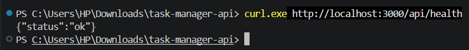

### 2. Створення користувача

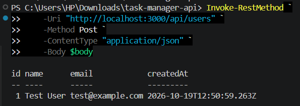

### 3. Отримання списку користувачів

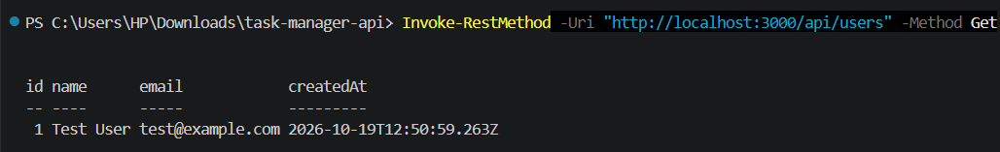

### 4. Створення проєкту


### 5. Отримання списку проєктів


### 6. Створення завдання

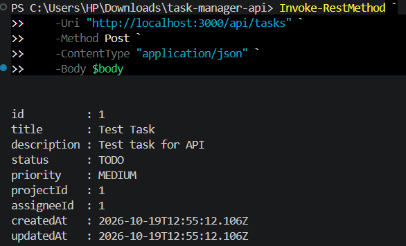

### 7. Отримання списку завдань

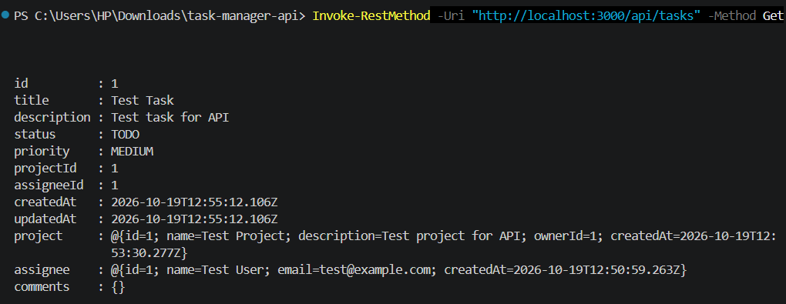

### 8. Створення коментаря

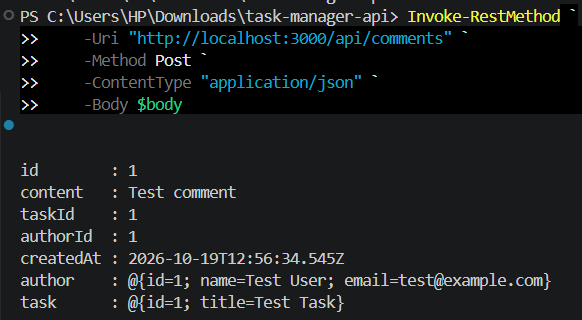

### 9. Отримання списку коментарів

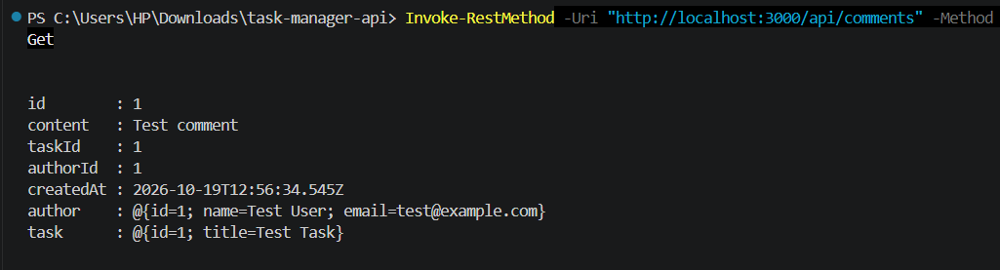

### 10. Оновлення завдання

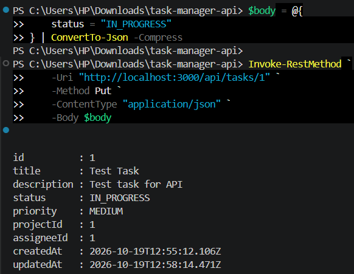

### 11. Видалення коментаря

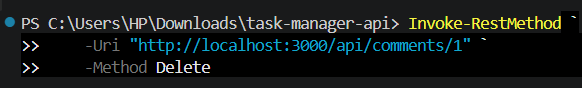

### 12. Отримання користувача за ID

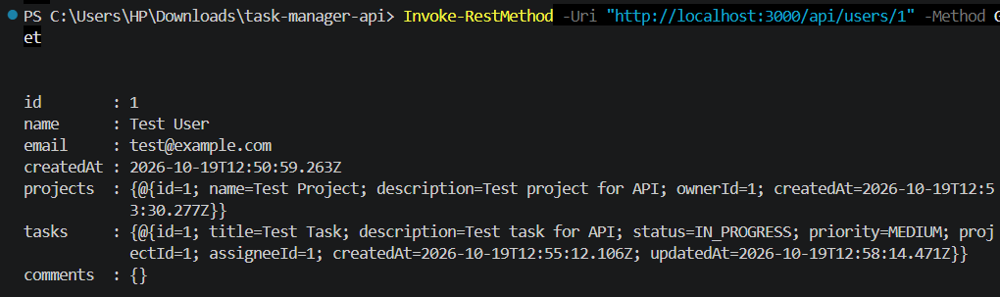

### 13. Оновлення користувача

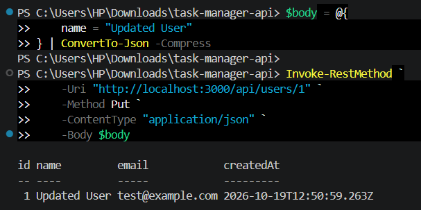

## Висновки

У ході виконання лабораторної роботи створено backend-застосунок Task Manager API з використанням Node.js, Express.js, PostgreSQL і Prisma ORM. Реалізовано основні операції для роботи з користувачами, проєктами, завданнями та коментарями. Перевірено роботу основних функцій API та підготовлено документацію проєкту.

**Самооцінка:** 4

